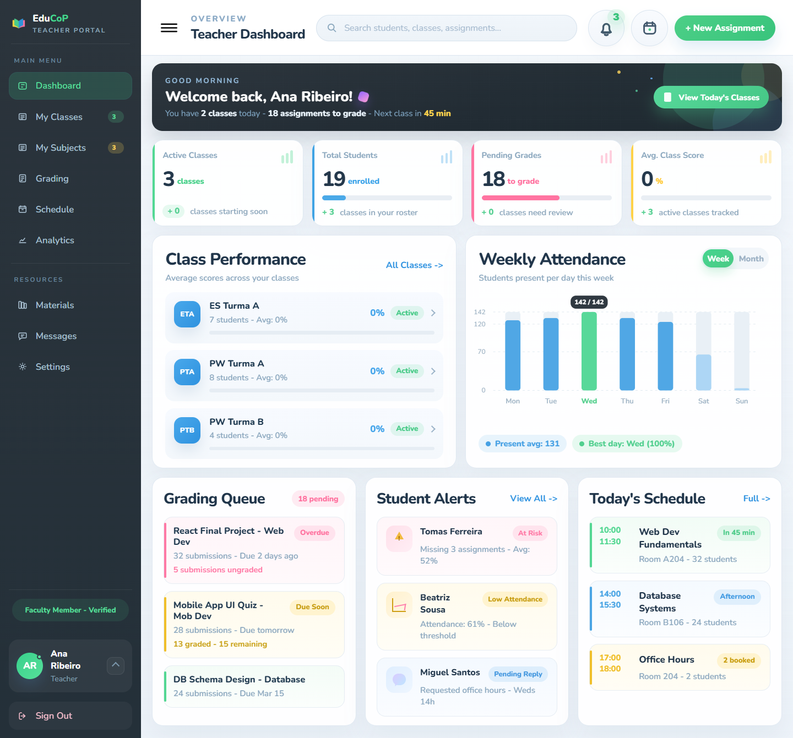
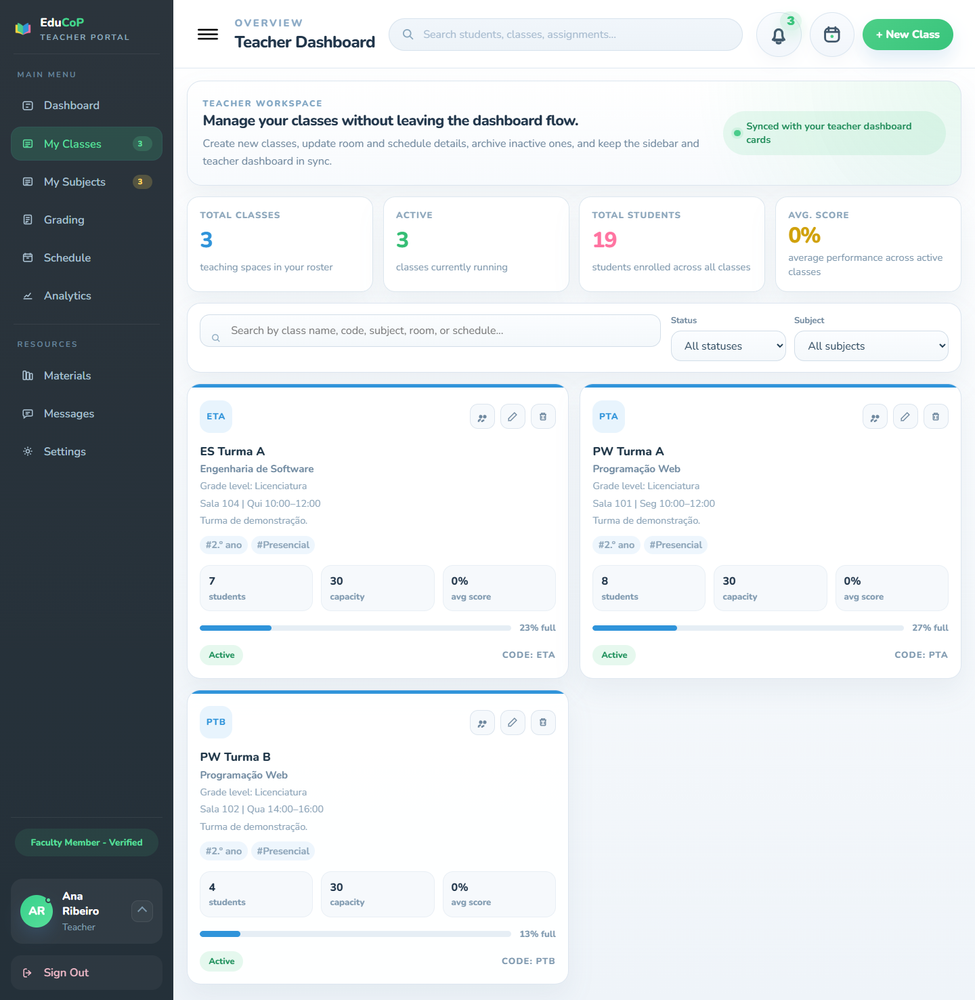
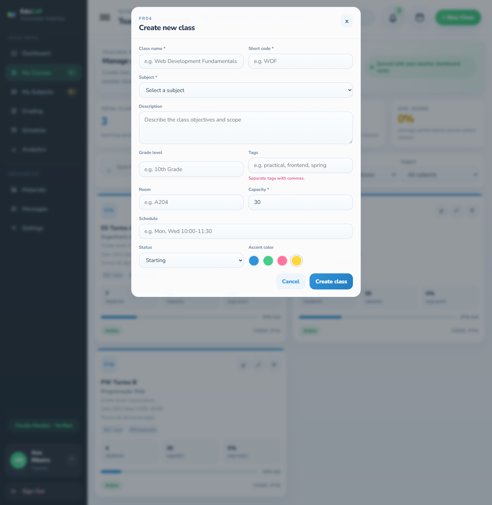

# EduCoP · Estudo de caso

> **EN:** Four-person group project from the third year of the Computer Engineering degree at Instituto Politécnico de Setúbal (2026): a web platform where schools manage classes, subjects and exams, built with Angular 19 and ASP.NET Core. I built the teacher-side frontend (dashboard, class management, layout) and wrote the backend test suite (49 tests, including performance and load tests). The source code is private; this page documents my part.

Projeto de grupo (4 pessoas) do 3.º ano da licenciatura em Engenharia Informática do Instituto Politécnico de Setúbal (2026), feito para as cadeiras de ESA e PV. A ideia e a coordenação do projeto foram do João Barbosa. **O código é privado**; esta página descreve a parte que fiz.

O **EduCoP** (*Community of Practice*) é uma plataforma web onde alunos, professores e administradores gerem turmas, disciplinas e exames online.

| | |
|---|---|
| **A minha parte** | Frontend da área do professor (dashboard, gestão de turmas, layout) e testes automáticos |
| **Stack do projeto** | Angular 19 · TypeScript · ASP.NET Core 9 Web API · Entity Framework Core · PostgreSQL · JWT · xUnit · GitHub Actions |

## O que fiz

### Frontend (Angular)
- **Dashboard do professor** e os seus componentes reutilizáveis: cartões de estatísticas, gráfico de atividade, banner de boas-vindas e progresso das turmas.
- **Gestão de turmas:** lista com pesquisa e filtros por estado e disciplina, e formulário para criar e editar turmas, com validação dos campos.
- **Serviço de turmas** que consome a API e mantém a dashboard e a barra lateral sincronizadas.
- **Layout da aplicação** (estrutura, barra lateral e cabeçalho) e o **interceptor HTTP** que junta o token JWT a cada pedido à API.

### Testes
- **49 testes do backend** (xUnit), todos a passar:
  - unitários dos controladores (autenticação, turmas, disciplinas, exames, alunos, professores e administradores);
  - de integração, com a API a correr sobre uma base de dados em memória;
  - **não funcionais:** performance, carga, stress, escalabilidade, pico de tráfego e estabilidade prolongada (*soak*).
- **13 dos 23 ficheiros de testes do frontend** (serviços e componentes).

## Imagens

| Gestão de turmas | Criar turma |
|---|---|
|  |  |

As capturas foram tiradas localmente com **dados fictícios**: a base de dados original do projeto já não está ativa.

## Notas

- Alguns cartões da dashboard (fila de correções, alertas de alunos, assiduidade semanal e horário) ainda usam dados de exemplo fixos no frontend: a ligação à API ficou por fazer.
- O código pertence ao grupo e não é público. Posso mostrar e explicar a minha parte numa entrevista.
